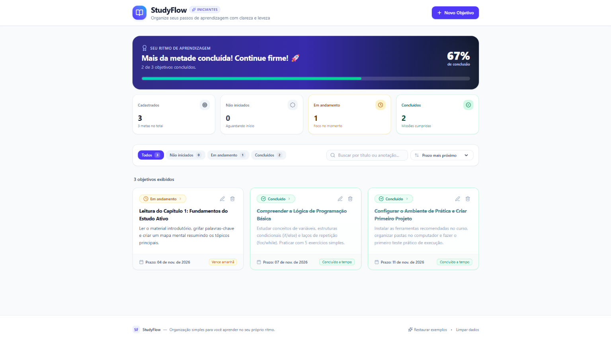

<h1 align="center">Boas-vidas ao projeto StudyFlow!📚</h1>
<br>
<div align="center"> 
  
  <strong>
      Criação do StudyFlow, uma aplicação simples para ajudar estudantes iniciantes a organizar objetivos de estudo.  
  </strong>
</div>

## Conheça o Projeto 
<p align="center">
  
</p>
<br>
<h2 align="center"><b><a href="#">Veja o Site</a></b></h2>
<br>

<br>
<br>

## Tabela de Conteúdos

* [Sobre](#-sobre)
* [Tecnologias utilizadas](#️-tecnologias-utilizadas)
* [Pré-requisitos e como rodar a aplicação/testes](#pré-requisitos-e-como-rodar-a-aplicaçãotestes)
* [Comandos Úteis](#-comandos-úteis)
* [Dicas Importantes](#-dicas-importantes)
* [Autor](#-autor)
* [Status do Projeto](#-status-do-projeto)
* [Licença](#-licença)

## 📕 Sobre

Foi construida uma aplicação com Inteligência Artificial chamada StudyFlow! Usando uma ferramenta, o Google AI Studio descobrindo como sair de uma ideia e chegar a uma aplicação 
web funcionando em poucos minutos, usando apenas uma conta Google e prompts bem estruturados.

## 👦🖥️ Tecnologias utilizadas

### 🔨 Tecnologias

As seguintes ferramentas foram usadas na construção do projeto:

**Interface**
- [HTML](https://developer.mozilla.org/pt-BR/docs/Web/HTML)
- [CSS](https://developer.mozilla.org/pt-BR/docs/Web/CSS)
- [JavaScript](https://developer.mozilla.org/pt-BR/docs/Web/JavaScript)
- [TypeScript](https://developer.mozilla.org/en-US/docs/Glossary/TypeScript)
- [React](https://developer.mozilla.org/pt-BR/docs/Learn_web_development/Core/Frameworks_libraries/React_getting_started)

**Servidor**
- [NodeJS](https://nodejs.org/pt-br)
- [Vite](https://vite.dev/)

## Pré-requisitos e como rodar a aplicação/testes

### 📝Pré-requisitos

Antes de começar, você vai precisar ter instalado em sua máquina a ferramenta
[Git](https://git-scm.com).
Além disto é bom ter um editor para trabalhar com o código como [VSCode](https://code.visualstudio.com/).
Para esse repositório é recomendado utilizar o [Antigravity IDE](https://antigravity.google/product/antigravity-ide)

### 1. Node.js instalado:
Recomenda-se a versão 18.x, 20.x ou superior (LTS).
Para verificar se você já tem instalado, abra o seu terminal e digite:

```bach
node -v
npm -v
```

### 🎲 Rodando o Front-End (cliente)

```bach
# Navegue até a pasta onde estão os arquivos do projeto (onde fica o package.json):
$ cd caminho/para/studyflow

# Execute o comando abaixo para baixar as bibliotecas necessárias (React, Tailwind CSS, Lucide, Vite, etc.):
$ npm install

# Esse processo criará a pasta node_modules com tudo o que o projeto precisa.

# Execute o script de desenvolvimento:
$ npm run dev

# Você verá uma mensagem no terminal semelhante a:
VITE v8.x.x  ready in 250 ms

  ➜  Local:   http://localhost:3000/
  ➜  Network: use --host to expose

# Abra o seu navegador (Chrome, Edge, Firefox, Safari) e acesse:
http://localhost:3000

# Pronto! O StudyFlow estará funcionando perfeitamente.
```

## Comandos Úteis

**Comando**	                  **O que faz**

npm run dev	                  Inicia o servidor local para você testar e programar em tempo real.

npm run build	                Cria a pasta otimizada dist para publicação em produção.

npm run preview	              Testa localmente o build gerado em produção.

npm run lint	                Valida se há algum erro de tipagem no TypeScript.

Ctrl + C (no terminal)	      Encerra o servidor de desenvolvimento.

## 💡 Dicas Importantes:
- **Persistência de Dados:** Como esta primeira versão utiliza o **LocalStorage**, os objetivos que você cadastrar ficarão salvos no próprio navegador da sua máquina. Mesmo se reiniciar o computador ou fechar o terminal, seus dados continuarão lá ao reabrir **http://localhost:3000**.

- **Porta em uso:** Se a porta 3000 já estiver sendo utilizada por outro programa, você pode alterar a porta temporariamente rodando **npx vite --port 5173** ou ajustando o script **"dev"** no arquivo **package.json**.

## 🧑‍🏫 Autor

<a href="https://github.com/G614/">
    
    <br>
    <sub><b>Gabriel Bispo Ribeiro</b></sub></a> <a href="https://cursos.alura.com.br/user/gb-30ribeiro">🚀</a>
<br><br>
<p>Feito com ❤️ por Gabriel Bispo Ribeiro 👋 Entre em contato!</p>
<br>

 
 


## 📊 Status do Projeto

<h3 align="center">
	<b>🚧  React Select 🚀 Em construção...  🚧<b>
</h3>

## 📜 Licença
<br>

[](https://github.com/G614/StudyFlow/blob/main/LICENSE)
